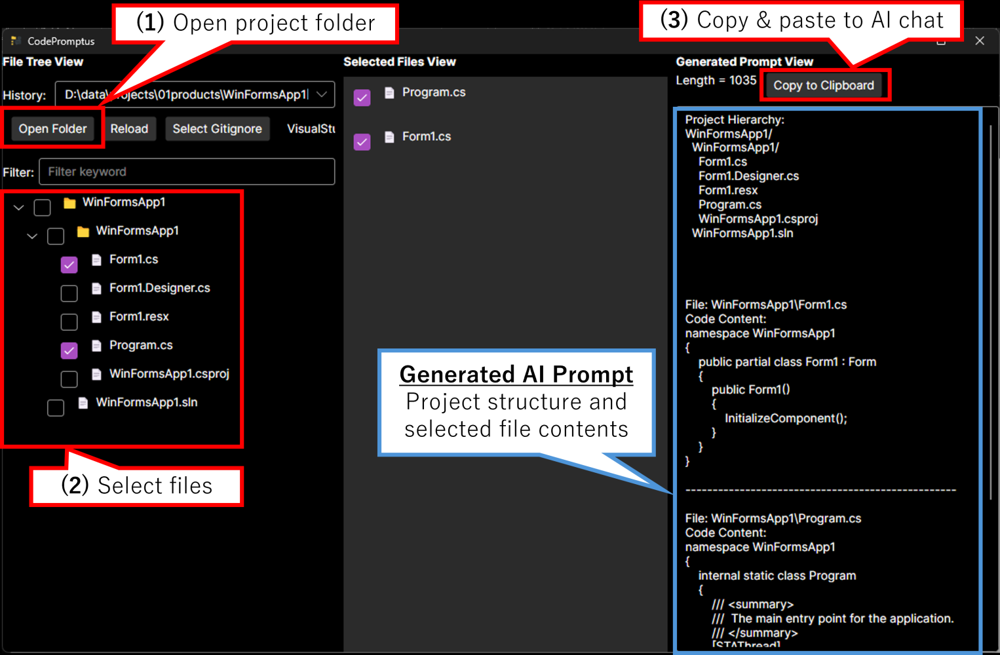

# CodePromptus
**Language:** [🇺🇸 English](README.md) | [🇯🇵 日本語](README.ja.md)

**👉 [Download the latest release here!](https://github.com/prota-p/CodePromptus/releases/)**

A desktop application that selects files from project folders and automatically generates AI prompts.

## Overview
A tool that enables developers to easily create prompts containing project structure and code content for efficient AI consultation about coding.

## Background
Developed to automate the manual copy-and-paste work when asking AI coding questions, streamlining the dialogue between developers and AI.

## Key Features
- Display project folder hierarchy structure
- File selection and filtering
- Automatic exclusion of unnecessary files using .gitignore templates
- Automatic AI prompt generation from selected files
- One-click copy of generated prompts

## Screenshots


## System Requirements
- Windows 11 (tested and confirmed)
- MacOS and Linux binaries are also available, but not tested.
- .NET 10.0
  - No separate installation of .NET 10.0 is required as the app binary is self-contained.

## Usage
1. Select a project folder with **"Open Folder"**
2. Choose an appropriate **.gitignore template** (preset templates are automatically configured)
3. **Select files** in the left tree
4. **Copy the generated prompt** on the right side
5. Paste into your preferred AI service (e.g., ChatGPT) and use

## Development

### Build and Debug Run
```bash
git clone https://github.com/prota-p/CodePromptus.git
cd CodePromptus
dotnet build
dotnet run --project App/CodePromptus.App.csproj
```

### Test Execution
Automated tests (unit, service, end-to-end) are provided in the `Tests` folder.  
**Note:** Current test coverage is basic and focuses on core scenarios. 

To run the tests:
```bash
dotnet test
```

### Binary Creation
```bash
dotnet publish App/CodePromptus.App.csproj -c Release -r [RID] --self-contained true -p:PublishSingleFile=true -o publish-[RID]
```
Replace [RID] with win-x64, osx-x64 or linux-x64 (the ones listed in `RuntimeIdentifiers` in the App project).

### Third-Party Licenses
License checks and the notices file shipped with the binaries are handled by [NoticeForge](https://github.com/prota-p/NoticeForge). The settings are in `ThirdPartyLicenses/noticeforge.json`.
```bash
dotnet tool restore

# May we use every dependency? (reads packages.lock.json)
dotnet noticeforge check -c ThirdPartyLicenses/noticeforge.json

# Build the notices for what was published (run after dotnet publish, once per RID)
dotnet noticeforge notices App/obj/Release/net10.0/[RID]/CodePromptus.App.deps.json -c ThirdPartyLicenses/noticeforge.json -o publish-[RID]/THIRD-PARTY-NOTICES.txt
```

### Adding or Updating Dependencies
Dependency versions are pinned in `packages.lock.json`, and restore fails when it does not match. After changing a package reference, update the lock files and review the diff:
```bash
dotnet restore -p:RestoreLockedMode=false
```

## Tech Stack
- Avalonia UI (.NET cross-platform UI)
- ReactiveUI (MVVM)
- Fluid (template engine)

## License
MIT License

## Contributing
Feel free to send Issues or Pull Requests.
By contributing to this repository (providing code, documentation, or other content), you agree that your contributions will be licensed under the MIT License.